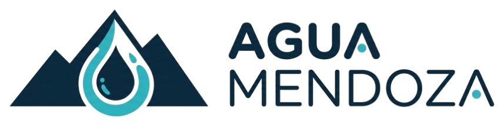
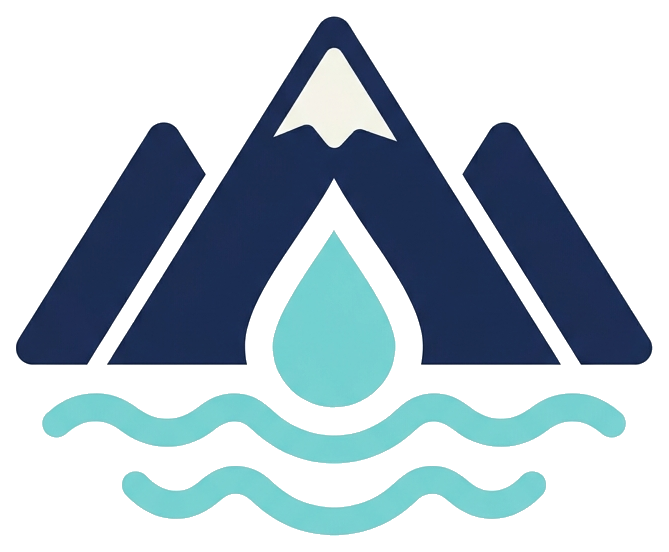

# Agua Mendoza



 

Mendoza está en emergencia hídrica. Esta app convierte los hábitos de una casa en litros por persona por día, los compara con Mendoza (400 L) y con la OMS (250 L), y deja probar cambios en vivo.

Hackatón Cursor Mendoza · 21 de noviembre de 2026.

## Qué se ve

Al calcular, la pantalla muestra:

- el total en grande y si estás por encima o por debajo de Mendoza y de la OMS
- un gráfico Vos / Mendoza / OMS
- el desglose por uso, de mayor a menor
- un simulador (minutos de ducha, descargas y riego) con el ahorro en litros por día
- la equivalencia en bidones de 20 L por mes

Con los hábitos de ejemplo (3 personas, ducha de 10 minutos, 5 descargas, 3 lavados de ropa por semana, 2 lavadas de platos, 60 minutos de riego, 2 lavados de auto y ninguna canilla goteando) el resultado es **237 L por persona por día**.

## Cómo correrla

```bash
npm install
npm run dev
```

La prueba del cálculo:

```bash
npm test
```

## Equipo

| Integrante | Parte | Archivos |
| --- | --- | --- |
| A | Formulario y flujo (Mi casa / Mi finca) | `src/components/Formulario.tsx`, `src/App.tsx` |
| B | Cálculos, gráficos y simulador | `src/lib/constants.ts`, `src/lib/calculo.ts`, `src/components/Resultado.tsx` |
| C | Modo finca | `src/lib/finca.ts`, `src/components/finca/` |
| Valentín | Consejos, deploy y pitch | `src/lib/fallback.ts`, `src/components/Consejos.tsx`, `api/consejos.ts` |

El contrato común está en `src/types.ts`. El cálculo se importa desde `src/lib/calculo`: `calcular`, `MENDOZA` y `OMS`.

## De dónde salen los números

Ducha 12 L/min (7 L/min si es ahorradora), referencia MITECO. Mendoza 400 L por persona por día (AySAM) y OMS 250 L. El resto de los usos sale de ERAS (argentina.gob.ar): descarga 10 L, lavarropas 75 L, platos 35 L, riego 500 L/hora, auto 400 L, canilla que gotea 50 L por día. Cada uso se redondea a litros enteros y el total es la suma de ese desglose.

En la finca, el 81% del agua de Mendoza va al agro. La eficiencia del riego a manto ronda el 35% y la del goteo el 85% (Gobierno de Mendoza / Irrigación, Unidiversidad UNCuyo). Es una estimación aproximada.
